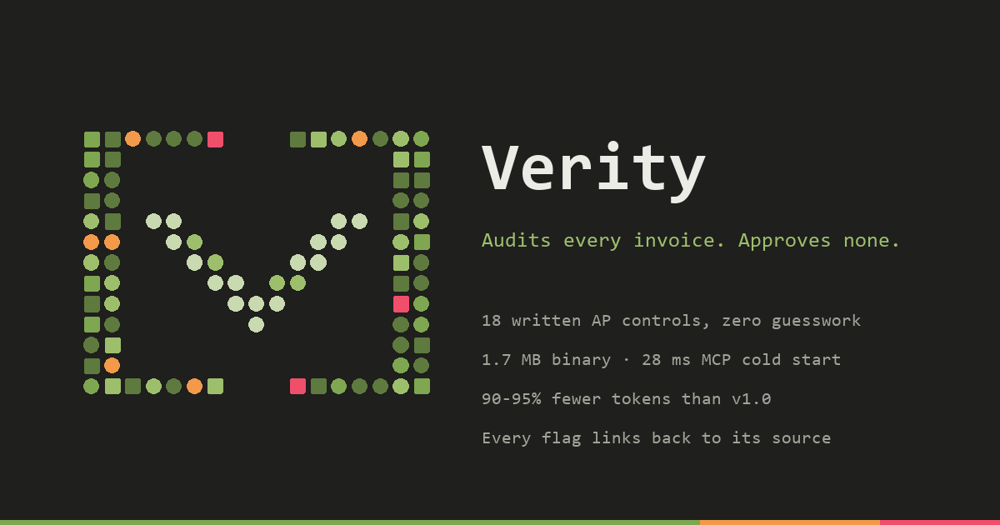

# Verity v1.1.0

Verity checks invoices and payments against eighteen written accounts-payable controls and tells you which are fine and which need a person. This release moves the verdict engine to Rust and ships it as one 1.7 MB binary: a CLI, an offline HTML report and an MCP server your agent can call. No Python, no database and no model are needed to get a verdict.

It never pays and never approves. Pass means no control objected.

## Measured on real public data

Every figure comes from [`docs/BENCHMARK.md`](https://github.com/uncoalesced/Verity/blob/main/docs/BENCHMARK.md). One command regenerates it from a hashed, offline snapshot of UK government payments (DCMS, over £25,000), US federal contract transactions (USAspending) and labelled receipts (CORD).

- **70.4%** of injected anomalies of the types the controls are built for are blocked with no human involved, and **99.7%** are raised for review.
- Across every injected type, including three no control is built to catch, the figures are 48.8% and 69.1% (2,931 cases).
- Around 150,000 payments a second. The MCP cold start is 28 ms.
- A default MCP audit response is 79 to 164 bytes, 90 to 95% smaller than v1.0's.
- The Rust and Python engines agree with 0 differences: 17,647 documents one at a time, including every real row, and 3,528 real payments in batch.

Out of the box it does not catch an inflated single-line payment or a supplier it has never seen, because nothing on the page can be checked against. The benchmark reports that by type, next to the false-alarm rate on untouched data.

## What's new

- **Native binary.** `verity audit` takes a document or a whole CSV/JSON file. `verity explain` prints any control's policy. `verity verify` checks a data snapshot offline. `verity mcp` runs the MCP server over stdio, or over `--http` for private, token-gated self-hosting.
- **Four forensic controls.**
  - P-015 Benford first-digit test. It is aware of truncated lists like "spend over £25k".
  - P-016 near-duplicate payment. The same supplier billing the same amount again within a week is blocked.
  - P-017 reused invoice number.
  - P-018 sequential invoice numbering.
- **Provenance.** Every finding carries its source file, row and sha256, plus links to the documents it relates to. The offline HTML report lets you click through. The MCP `trace` tool gives an agent the same thing.
- **Currency awareness** for round amounts and rounding tolerance.
- **Honest gaps.** A duplicate check with no history reports *not evaluated*, never a silent pass.
- **Token-lean MCP.** `audit`, `audit_batch`, `explain` and `trace` give compact answers by default. Full evidence only when asked.
- **New identity.** The bracket-V dot-matrix mark in green, amber and watermelon, with shape-coded verdicts. See [`DESIGN.md`](https://github.com/uncoalesced/Verity/blob/main/DESIGN.md).

## Security

Verity treats every document as hostile.

- Verdicts come from code, so text in a document can't argue a finding away.
- The default agent output contains no document text at all.
- Unknown fields, oversized input and ambiguous amounts are refused.
- No tool touches files, processes or the network.
- HTTP mode requires a token and checks `Origin`.
- The HTML report is escaped under a strict CSP. CSV exports are formula-safe.

## Install

Download the archive for your platform below. Check it against `SHA256SUMS`, unpack, and put `verity` on your `PATH`. Or:

```bash
cargo install --git https://github.com/uncoalesced/Verity --tag v1.1.0 verity
```

```bash
docker run -i --rm ghcr.io/uncoalesced/verity:1.1.0
```

Then add it to your agent. For Claude Code:

```bash
claude mcp add verity -- verity mcp
```

The [README](https://github.com/uncoalesced/Verity#use-it-from-your-agent-mcp) has the config for Claude Desktop, Cursor, Windsurf, VS Code, Gemini CLI, Antigravity, Codex and ChatGPT.

| Platform | Archive |
|---|---|
| Windows x64 | `verity-v1.1.0-x86_64-pc-windows-msvc.zip` |
| macOS Apple Silicon | `verity-v1.1.0-aarch64-apple-darwin.tar.gz` |
| macOS Intel | `verity-v1.1.0-x86_64-apple-darwin.tar.gz` |
| Linux x64 | `verity-v1.1.0-x86_64-unknown-linux-gnu.tar.gz` |
| Linux arm64 | `verity-v1.1.0-aarch64-unknown-linux-gnu.tar.gz` |

## Upgrading from v1.0

- The Python console script is now `verity-py`. `verity` is the native binary. `verity-mcp`, the v1.0 HTTP-client server, still works.
- If you use the Postgres ledger, run `uv run alembic upgrade head` to apply migration 0004 (`invoice_number`, `currency`, `source_sha256`).
- Python dependencies with published advisories (pypdf, Pillow, PyJWT, aiohttp, filelock, urllib3) are upgraded.

Full list: [CHANGELOG.md](https://github.com/uncoalesced/Verity/blob/main/CHANGELOG.md).

Benchmark data contains public sector information licensed under the Open Government Licence v3.0. USAspending.gov data is public domain. CORD v2 labels are CC BY 4.0.

Engineered by [uncoalesced](https://github.com/uncoalesced).
